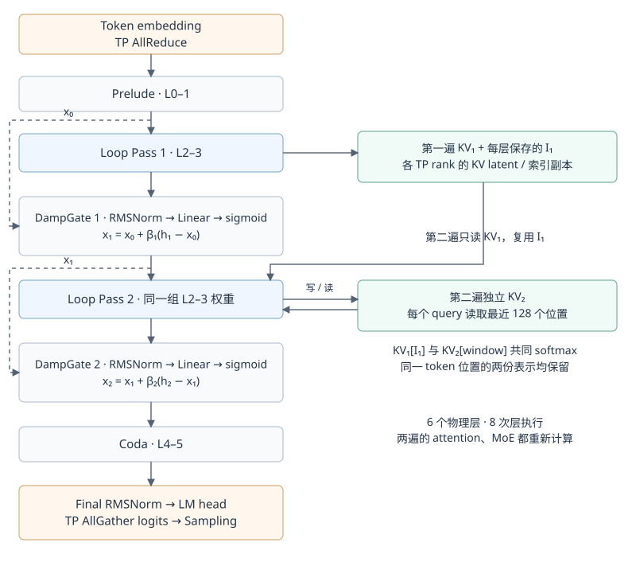
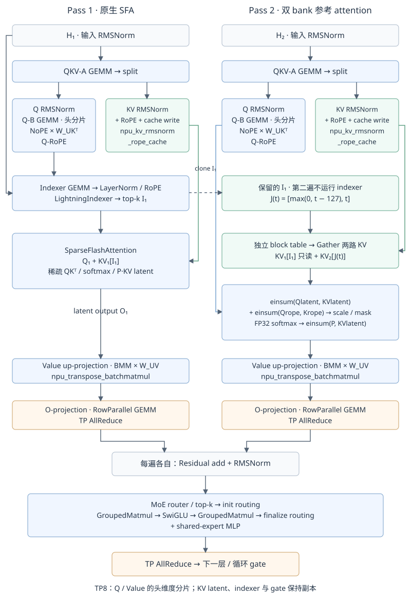
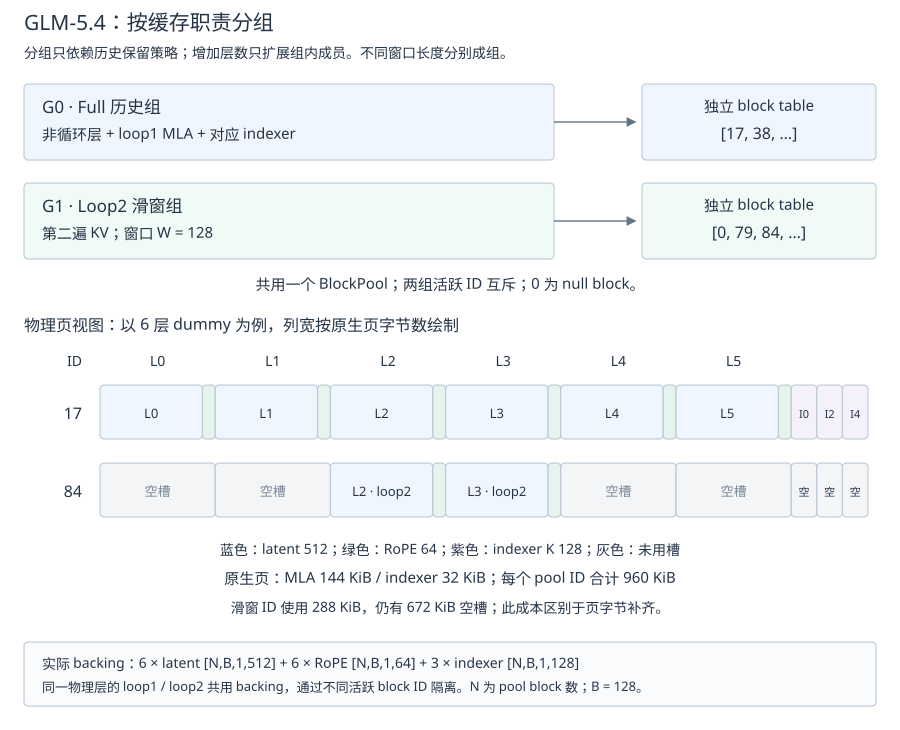

# GLM-5.4 dummy 文本模型

`Glm54DummyForCausalLM` 复用 GLM-5.3 DSA 主干，按照[公开的 GLM-5.4 架构](https://z.ai/blog/glm-5.4)实现固定两遍循环、独立门控、索引复用和双 KV attention。它用于验证框架与算子的数据流；配置字段、门控权重名采用实验约定，尚未对接正式 GLM-5.4 checkpoint。

## 层执行与状态

`loop_start_layer` 包含起点，`loop_end_layer` 不包含终点，均采用零基层号。下面的 dummy 保留 6 组物理层权重，执行 8 次层计算；两遍复用同一组 Layer 对象，各自重新运行 attention 和 MoE。



每遍的 gate 从本遍输入计算 `sigmoid(Linear(RMSNorm(x)))`，在循环段结束后插值输入与候选输出。第一遍按层保留 KV 和本轮查询的 top-k 索引；第二遍将新 KV 写入另一组缓存，通过原索引读取第一遍 KV，并读取本遍的因果窗口。相同 token 位置的两份表示共同参与归一化。

MoE dispatcher 的调用序列也需要展开。重复的层名指向同一组专家权重，物理专家数量保持不变。

## 当前算子路径

Prefill 和 decode 沿下图执行。Prefill 根据每个 query 的绝对位置计算因果窗口；decode 使用新 token 的位置读取历史缓存。箭头表示数据依赖，不表示耗时或并行执行。



第一遍调用原生 SparseFlashAttention。第二遍采用参考实现：分别 gather 两个 bank 的条目，用第二遍 Q 计算分数，在 FP32 中对合并后的条目执行一次 softmax，再沿用 Value 和 O 投影。它当前没有使用 two-bank 融合算子或两次 attention 加 LSE merge。

TP 将 Q-B、KV-B 和 Value 的头维度分片；O 投影和 MoE 输出沿用已有 AllReduce。QKV-A、KV latent、indexer 和 gate 保持各 rank 副本。图中的 KV 写入使用独立 slot mapping，读取使用各自的 block table。

## 缓存分组与原生页

首遍采用 full-attention 管理，第二遍采用 sliding-window 管理。Indexer cache 与其首遍 attention 共用逻辑 block table，第二遍不新增 indexer cache。首遍 TopK 索引只保存到本次第二遍计算结束。

分组依据缓存职责和保留策略，不按层数、indexer 数量或它们的比例拆分。完整模型与 dummy 使用相同规则：所有非循环层、循环第一遍的 MLA 以及所属 indexer 合为一个 full 组；循环第二遍的 KV 按窗口长度分组。当前只有一种窗口长度，因此共两个组。Indexer 与主 KV 页大小不同仍可共用 full block table；首遍 TopK 是本次 forward 的临时结果，不注册为持久缓存组。



各组从同一个 block pool 获取互斥的活跃 ID；同组内各层使用不同槽。物理槽按缓存角色、原生页大小和物理层身份建立，Loop2 与所属物理层的首遍 MLA 共享 backing。Loop2 根据自己的 block table 写入新 KV，根据首遍 block table 读取历史 KV，活跃页的 ID 必须不同。增加层数只扩展组内成员，不增加同一保留策略的组数；不同窗口长度需要不同滑窗组。

当 block size 为 128、KV 为 BF16 时，每个 MLA 页为 `128 × (512 + 64) × 2 = 144 KiB`，indexer 页为 `128 × 128 × 2 = 32 KiB`。当前 dummy 的 full 组包含六层 MLA 和三个 indexer，每个 pool ID 成本为 `6 × 144 + 3 × 32 = 960 KiB`。实际分配十五个连续 backing：六个 latent、六个 RoPE 和三个 indexer。Indexer 小页不补齐成 MLA 大页。

当前引擎的 device block pool 仍采用统一 ID 容量，分组职责与物理容量尚未完全解耦。SWA ID 只使用两层 MLA，对应的其他四层 MLA 和三个 indexer 槽仍占用 672 KiB。这是共享池的空槽成本，区别于页字节补齐；独立的按职责容量需要额外的多池或 ID 映射支持。当前不通过拆分 full 层组来规避该成本。128 MiB 预算按该布局可分配 136 个 pool block；旧四组布局的容量结果不能用于当前两组布局。

滑窗按本步所有 query 所需位置的并集保留 KV。窗口为 `W`、本次请求有 `Q` 个新 token 时，最多需保留 `W − 1 + Q` 个位置，另外考虑分页对齐。例如 `W=128、Q=256` 时，框架的保守 admission 上限为 4 页。页释放由引擎根据已计算 token 位置管理，支持一次写入大于窗口的 prefill chunk。

固定 `--kv-cache-memory-bytes` 时仍会预分配整个池；减少缓存浪费会增加该预算下的有效容量。当前支持范围内，hybrid KV cache manager 必须开启。

## Checkpoint 配置

保留 GLM-5.3 的 `model_type: glm_moe_dsa` 和 tokenizer，为形状一致的 BF16 随机 checkpoint 增加以下字段：

```json
{
  "architectures": ["Glm54DummyForCausalLM"],
  "glm54_dummy": true,
  "num_hidden_layers": 6,
  "num_attention_heads": 16,
  "index_n_heads": 8,
  "index_topk": 32,
  "loop_start_layer": 2,
  "loop_end_layer": 4,
  "loop_window_size": 128
}
```

新增权重为 `model.damp_gates.{0,1}.norm.weight`，形状 `[hidden_size]`，以及 `model.damp_gates.{0,1}.proj.weight`，形状 `[1, hidden_size]`。其余权重沿用 GLM-5.3 的加载规则。随机参数不能用于模型精度评测。

## 混部 TP8 启动

在安装本分支的 Ascend 容器中执行，模型路径替换为实际 dummy checkpoint：

```bash
vllm serve /path/to/glm54-dummy \
  --served-model-name glm54-dummy \
  --tensor-parallel-size 8 --distributed-executor-backend mp \
  --dtype bfloat16 --enforce-eager --no-enable-prefix-caching \
  --max-model-len 1024 --max-num-batched-tokens 256 --max-num-seqs 4 \
  --kv-cache-memory-bytes 134217728 --seed 20261125
```

混部 P/D 共用同一个引擎，DP、PP、PCP、DCP 均为 1。`num_attention_heads` 必须能被 TP 整除。上面的 16 个头在 TP8 中每个 rank 处理 2 个头。

```bash
curl http://localhost:8000/v1/models
curl http://localhost:8000/v1/completions \
  -H 'Content-Type: application/json' \
  -d '{"model":"glm54-dummy","prompt":"Hello","temperature":0,"max_tokens":8}'
```

当前执行范围为 BF16、Q-LoRA、RoPE、未量化权重和 `auto` KV dtype。Sequence-parallel MoE、EP、图执行、前缀缓存、KV transfer 和推测解码会被拒绝；该 dummy 没有视觉模块或 MTP 权重。
